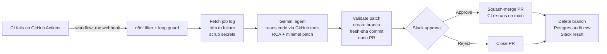

# CI Autofix: self-healing CI with n8n, Gemini, and Slack approval

When a GitHub Actions build fails, an n8n workflow fetches the failing log, trims it to the actual error, and sends it to a Gemini agent. The agent reads the repository's code, works out the root cause, and drafts a minimal fix. The workflow then opens a pull request with a root-cause analysis (RCA) and asks a human in Slack to approve or reject it. **Nothing is merged without that Slack approval.** Every incident is recorded in a Postgres audit table.

---

## How it works



| Stage | n8n nodes | What happens |
|---|---|---|
| **Ingest** | Webhook → Is failed run? | Accepts only `workflow_run` events that are `completed` with `failure`. Ignores fix branches (`autofix/*`) and the workflow's own merge commits (`[autofix]`). |
| **Isolate** | Get jobs → Find failed job → Get job log → Download log → Trim log | Finds the failed job and step. Downloads the log in two steps (GitHub returns a 302 redirect to Azure storage, which rejects the GitHub token). Keeps only pytest's `FAILURES`/`ERRORS` block, **scrubs secrets**, and caps the result at 8k characters. |
| **Diagnose** | Diagnose (AI Agent) + Gemini + 3 tools | A Tools Agent using `get_file_contents`, `list_repo_files` and `list_recent_commits`, pinned to the failing commit's sha. It returns structured JSON: root cause, evidence, bug location (source or test), confidence, and a find/replace patch. |
| **Patch & PR** | Parse diagnosis → Prepare fix → Get base ref → Create branch → Get file (fresh sha) → Apply patch → Commit file → Open PR | Validates the patch, creates `autofix/run-<id>-<timestamp>` from the tip of `main`, **fetches the file right before committing** (the sha-refresh pattern), applies the edits, commits, and opens a PR containing the RCA and the failing log. |
| **Human in the loop** | Slack approval → Approved? → Merge PR / Close PR → Delete branch | Posts the RCA, the diff and the PR link to `#ci-autofix` with Approve and Reject buttons, then pauses until someone clicks one. Approve squash-merges the PR, which pushes to `main` and so re-runs CI. Reject closes the PR. |
| **Audit** | Build audit row → Log incident → Notify result | Inserts the error, RCA, patch, PR, resolution and duration into Postgres, then posts the outcome to Slack. |
| **Errors** | Separate workflow: Error Trigger → Alert Slack | If any step fails (low confidence, a patch that doesn't match, an API error), a ⚠️ alert with a link to the failed execution is posted to Slack. |

## Safety and hardening

| Risk | Mitigation |
|---|---|
| **Log blowup** | The log is cut to the failing step's pytest block and capped at 8,000 characters. A typical run goes from about 200 lines to about 15. |
| **Hallucinated patches** | Edits are exact-match find/replace, and each `find` must match **exactly once** or the run aborts. Patches are limited to one file and at most 5 edits. The prompt forbids unrelated changes, extra validation, or weakening tests, and requires evidence quoted from code the agent actually read. Low confidence aborts the run. **Only the Slack Approve button can reach the merge step.** |
| **Rate limits** | The agent is capped at 8 iterations (5 proved too few for multi-file investigations). All GitHub calls are scoped to one repo. Gemini calls retry on 503 errors (5 tries, 5 s apart). |
| **Infinite loops** | The IF filter ignores runs on `autofix/*` branches and runs whose commit message contains `[autofix]`, which is the prefix every auto-merge commit gets. Tested with a failing PR from `autofix/loop-test`: the execution stopped at the filter in 37 ms. |
| **Secret leaks** | GitHub, Slack, Google, AWS and OpenAI-style keys, JWTs, Bearer tokens, `password=`/`token=` values and credentials in URLs are redacted from the log **and** the commit message before the LLM sees them. The redacted text is also what appears in Slack and in the PR. |
| **Stale commits** | The file is always re-fetched from the fix branch immediately before the `PUT`. Re-running the commit with an old sha returns **409 Conflict**, which shows why the refresh matters. |
| **Least privilege** | A fine-grained PAT limited to this single repository. All secrets live in n8n's encrypted credential store, and none are in the repo. The approval links resolve to `localhost`, so nobody on the internet can approve a merge. |

## Tech stack

n8n 2.38 (Docker) · Google Gemini Flash (n8n LangChain Tools Agent) · GitHub REST API · GitHub Actions + pytest · Slack (Send and Wait for approval) · PostgreSQL 16 (Docker) · ngrok (static domain)

## Repository layout

```
.github/workflows/ci.yml        CI: pytest on push to main and on PRs
calc/ops.py                      Small codebase with known-bug targets
tests/test_ops.py                Test suite the agent fixes against
n8n/ci-autofix.json              Main workflow (export)
n8n/ci-autofix-error-alert.json  Error-alert workflow (export)
scripts/start_n8n.bat            Starts Postgres + n8n + ngrok (Windows; fill in the placeholders)
sql/create_audit_table.sql       Audit table schema (no data, no secrets)
```

## Setup guide

**Prerequisites:** Docker Desktop, the ngrok CLI (v3.20 or later) with a free static domain, a GitHub account, a Google AI Studio API key, and a Slack workspace.

1. **Repository and CI.** Fork or clone this repo. Actions runs `ci.yml` on every push to `main` and on every PR.
2. **GitHub PAT.** Create a fine-grained token limited to this repo with these permissions: *Actions: read, Contents: read/write, Pull requests: read/write*.
3. **Start the stack.** Open `scripts/start_n8n.bat` and replace the two placeholders at the top: `NGROK_DOMAIN=your-domain.ngrok-free.dev` becomes your static ngrok domain, and `PG_PASSWORD=change-me` becomes a password of your choice. Keep this filled-in copy local and never commit it. Then run it. It starts `ci-audit-db` (Postgres), `n8n`, and the ngrok tunnel. `WEBHOOK_URL` is set to `http://localhost:5678/`, so the Slack Approve and Reject links go directly to n8n on this machine and are never exposed through the tunnel. Only GitHub's webhook uses the public ngrok URL.
4. **Create the audit table.**
   ```
   docker exec -it ci-audit-db psql -U n8n -d ci_audit
   ```
   Then paste in `sql/create_audit_table.sql`.
5. **Slack app.** Go to api.slack.com/apps → *Create New App* → *From a manifest* and use the bot scopes `chat:write` and `channels:read`. Install it to your workspace, create `#ci-autofix`, and run `/invite @CI Autofix` there.
6. **n8n credentials.** Create four:
   - **GitHub API:** your PAT.
   - **Google Gemini (PaLM) API:** your AI Studio key.
   - **Slack API:** the `xoxb-` bot token.
   - **Postgres:** host `host.docker.internal`, port `5432`, database `ci_audit`, user `n8n`, password = the `PG_PASSWORD` you set in step 3, SSL disabled.
7. **Import the workflows.** Import `n8n/ci-autofix-error-alert.json` and `n8n/ci-autofix.json`, attach the credentials to each node, and choose `#ci-autofix` as the Slack channel. In the main workflow, open *Settings* and set *Error Workflow* to **CI Autofix - Error Alert**. Then **Publish** both workflows.
8. **Webhook.** In the repo, go to *Settings → Webhooks → Add webhook*. Set the Payload URL to `https://<NGROK_DOMAIN>/webhook/ci-failure`, the content type to `application/json`, and select the **Workflow runs** event only.

**Try it:** change `add` in `calc/ops.py` to `return a - b` and push to `main`. Within about a minute, `#ci-autofix` shows the diagnosis and the diff. Click **Approve & merge**, and CI goes green again.

## Audit log

```sql
SELECT id, run_id, resolution, duration_seconds, patch_file, pr_number, root_cause
FROM ci_incidents ORDER BY id;
```

| Column | Meaning |
|---|---|
| `error_excerpt` | The trimmed and scrubbed failing log (up to 2,000 characters) |
| `root_cause`, `bug_location`, `confidence` | The agent's RCA |
| `patch_file`, `branch`, `pr_number`, `pr_url` | What was changed and where |
| `resolution` | `approved_merged`, `rejected_closed`, or `approved_merge_failed` |
| `failed_at`, `resolved_at`, `duration_seconds` | Time from the CI failure to the human decision |

## Tested scenarios

| # | Induced failure | Agent's fix | Outcome |
|---|---|---|---|
| 1 | Off-by-one in `average()`, with a misleading commit message ("prevent division by zero") | Ignored the message and fixed the `+ 1` in the source | Diagnosis verified (Phase 1) |
| 2 | `divide` renamed to `div`, causing an `ImportError` during test collection | Updated the test imports and calls (PR #1, +3/−3) | Merged, CI green |
| 3 | `average()` off-by-one again | The first attempt also added an unrequested empty-list guard (PR #2, +3/−1). I tightened the prompt and re-ran: PR #3 was +1/−1 | PR #2 closed, PR #3 merged |
| 4 | `add` returned `a - b` | One-line source fix (PR #4) | **Approved in Slack**, then merged, audited and CI green |
| 5 | `div` returned `a * b` | One-line source fix (PR #5) | **Rejected in Slack**, PR closed, audited (59 s) |
| 6 | Failing PR from `autofix/loop-test` | None (filtered out) | Loop guard stopped it in 37 ms |
| 7 | `add` bug plus a test that prints a fake `sk-...` API key | One-line fix (PR #7). The log showed `API_KEY=[REDACTED_API_KEY]` | Key never reached the LLM, Slack or the PR. Merged |
| 8 | `add` returned `a * b` (full end-to-end run with approval on `localhost`) | One-line fix (PR #8); the PR's own CI passed before merge | **Approved and merged 92 s after the failure**, then CI went green on `main` |

## Known limitations and future work

- **Single-file patches.** Fixes that need changes in several files are rejected by design. A multi-file version would need a git-tree commit.
- **Secret scrubbing covers logs and commit messages.** Source files the agent reads through `get_file_contents` are not scrubbed. Secrets should never be committed in the first place.
- **Log trimming is tuned for pytest.** Other test runners fall back to the failing step's section, which is still capped at 8,000 characters.
- **Approval does not yet require the PR's own CI to pass.** The *Checks* tab shows the result, but merge-on-approve could also wait for `CI / test (pull_request)` to go green first.
- **Approval waits have no time limit.** A timeout could auto-close stale PRs.
- **Approvals happen on the host machine.** The Approve and Reject links point to `localhost`. This keeps them private and avoids ngrok's free-plan browser warning page. To approve from another device, set `WEBHOOK_URL` to a public URL that has no warning page (for example, Tailscale Funnel or a paid ngrok plan).
- **The webhook isn't signed.** The workflow doesn't yet verify GitHub's `X-Hub-Signature-256`. The PAT is scoped to one repo, so a forged payload can only make the workflow fail, but adding a webhook secret and checking it in n8n would close that gap.
- **Free-tier limits.** The Gemini free tier returns 429 and 503 errors under load.

---

Built by **Muhammad Qasim Tahir** as a three-week n8n project: Week 1 ingestion and diagnosis · Week 2 patch and PR automation · Week 3 human-in-the-loop, audit and hardening.
